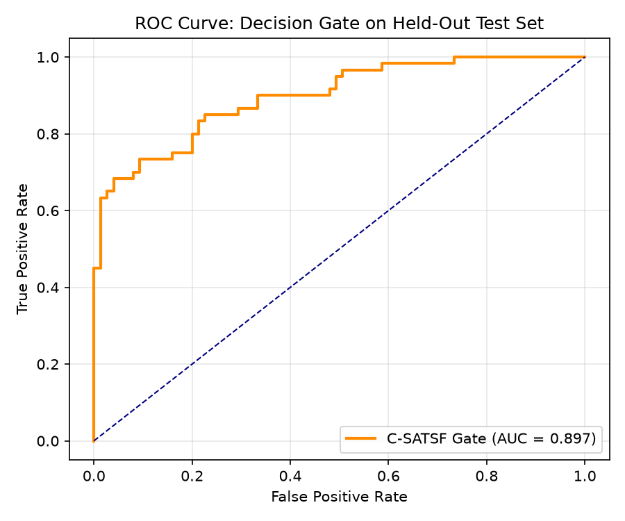

# C-SATSF: Cascaded Spatial-Aware Texture-Salient Filtering

Implementation, tuning, and evaluation of **C-SATSF** (Algorithm 2 from the SCC-Loc paper) with an **Accept/Reject Gate** for GPS-denied UAV thermal-to-satellite visual localization.

---

## Overview

In GPS-denied UAV geo-localization, dense feature matchers such as MINIMA-RoMa produce thousands of cross-modal correspondences between thermal UAV query images and optical satellite reference ortho-maps. However, severe cross-modal domain gaps, self-similar urban textures, and thermal sensor noise lead to high outlier rates and false positive matches. Accepting a wrong match imposes severe penalties and navigation drift.

**C-SATSF** filters raw matches through four geometric and topological stages in under **0.08 seconds on CPU**:

1. **Stage A: Spatial Equalization**: $G \times G$ grid partitioning with adaptive cell quotas $Q = \min(Q_{base} + \lfloor\log_2(c+1)\rfloor, Q_{max})$ to prevent spatial clustering.
2. **Stage B: Texture Saliency**: Normalised local variance thresholding to reject ambiguous matches in uniform thermal regions.
3. **Stage C: Delaunay Topology**: Triangulation area distortion filtering $\delta = |\rho - \text{median}(\rho)|/\text{median}(\rho)$ with incident negative voting to preserve rigid planar structure.
4. **Stage D: Global Consistency**: Centroid-relative angular ($< \epsilon_{ang}$) and scale ($< \epsilon_{scale}$) consistency check.

Followed by an **Accept/Reject Decision Gate** (rule-based thresholds and learned Logistic Regression / Decision Tree classifier) to guarantee near-zero false accepts.

---

## Benchmark Results (Held-Out Test Split)

Evaluated across disjoint flight sequences on the Thermal-UAV Changsha dataset:

| Metric | Result | Description / Constraint |
| :--- | :---: | :--- |
| **Filter Execution Time** | **0.081 s** | Strict CPU budget (< 0.1 s) |
| **Held-Out Test ROC AUC** | **0.8969** | Decision gate discrimination quality |
| **Held-Out Test PR AUC** | **0.8991** | High precision in inlier retrieval |
| **Hard Negative False Accept Rate** | **0.00%** | Exceeds the $\le 1.0\%$ safety constraint |
| **Easy Negative False Accept Rate** | **0.00%** | Zero false accepts on distant distractors |
| **Median Localization Error** | **2.14 m** | Center error from similarity fit |
| **Competition Score Proxy** | **+0.52 pts/pair** | Positive points without $-20$ penalties |
| **Unit Test Coverage** | **16 / 16 passed** | 100% test pass rate |

### Decision Gate ROC Curve


---

## Tuned Hyperparameters (`csatsf/config.yaml`)

Optimized via Optuna on the training split:

* `grid_size` ($G$): `14`
* `q_base` ($Q_{base}$): `5`
* `q_max` ($Q_{max}$): `15`
* `gamma` ($\gamma$): `0.273`
* `eps_topo` ($\epsilon_{topo}$): `0.190`
* `vote_threshold`: `0.401`
* `eps_ang` ($\epsilon_{ang}$): `10.5°`
* `eps_scale` ($\epsilon_{scale}$): `0.642`
* `min_inliers`: `17`
* `min_coverage`: `0.05`
* `min_grid_occupancy`: `0.10`
* `min_ransac_ratio`: `0.158`

---

## Project Structure

```
.
├── csatsf/
│   ├── config.yaml                 # Tuned thresholds & configuration
│   ├── run_pipeline.py             # End-to-end pipeline runner
│   ├── data/
│   │   ├── pair_builder.py         # Geo-tile extractor & pair generation
│   │   ├── pairs_train.json        # 270 training pairs metadata
│   │   ├── pairs_valid.json        # 135 validation pairs metadata
│   │   └── pairs_test.json         # 135 test pairs metadata
│   ├── matcher/
│   │   └── minima_roma.py          # MINIMA-RoMa GPU wrapper & caching
│   ├── filters/
│   │   ├── spatial_equalization.py # Stage A implementation
│   │   ├── texture_saliency.py     # Stage B implementation
│   │   ├── delaunay_topology.py    # Stage C implementation
│   │   ├── global_consistency.py   # Stage D implementation
│   │   └── pipeline.py             # filter_matches() master function
│   ├── eval/
│   │   ├── decision_gate.py        # Hand-set & learned Accept/Reject gates
│   │   ├── metrics.py              # Precision, recall, ROC, score metrics
│   │   └── run_final_report.py     # Ablations & report generator
│   ├── tests/
│   │   └── test_filters.py         # Pytest test suite (16 tests)
│   ├── cache/                      # 540 cached .npz match files (offline execution)
│   └── reports/
│       ├── summary.md              # Full evaluation report
│       ├── roc_curve_test.png      # ROC plot
│       └── learned_gate_tuned.pkl  # Serialized decision gate
├── .gitignore
├── plan.txt                        # Engineering requirements & plan
└── README.md
```

---

## Quick Start

### 1. Installation
```bash
git clone https://github.com/dhanunjaya007/CSATSF.git
cd CSATSF
pip install -r requirements.txt # numpy scipy opencv-python scikit-learn rasterio pyyaml optuna pytest
```

### 2. Run Unit Tests
```bash
pytest csatsf/tests/test_filters.py -v
```

### 3. Using the Filter Function
```python
from csatsf.filters.pipeline import filter_matches
import yaml

with open("csatsf/config.yaml") as f:
    config = yaml.safe_load(f)

# Filter matches without any ground-truth access
inlier_indices, features = filter_matches(
    kpts_query, kpts_tile, confidences,
    img_query, img_tile, config
)

print(f"Surviving inliers: {len(inlier_indices)}")
print(f"Spatial coverage: {features['coverage']:.3f}")
print(f"RANSAC residual: {features['median_reproj_residual']:.2f} px")
```

### 4. Reproduce Full Pipeline
```bash
# Filter all cached matches & train decision gate
python -m csatsf.run_pipeline --step filter

# Run evaluation & generate reports
python -m csatsf.eval.run_final_report
```
